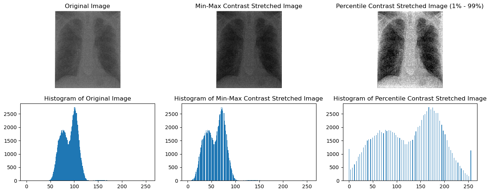
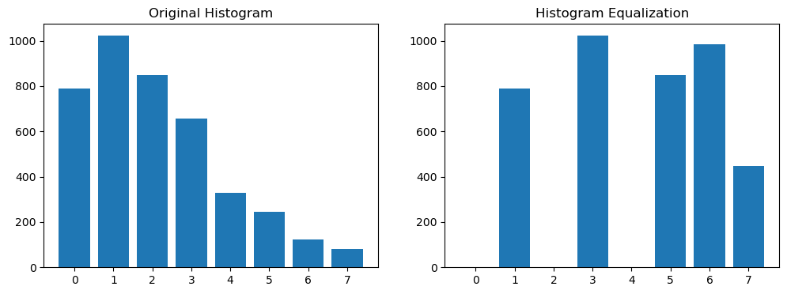
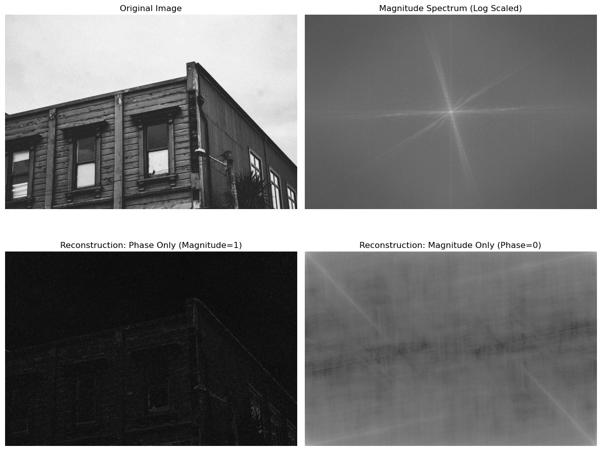
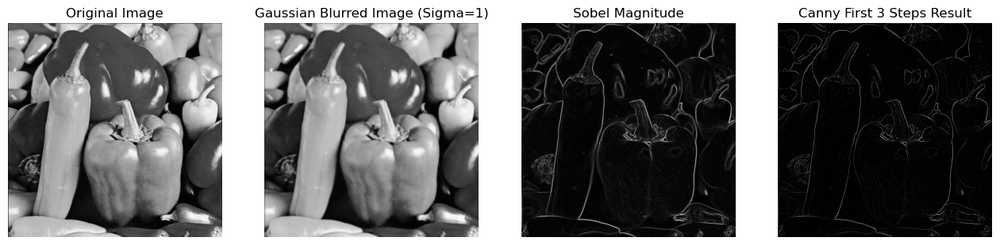
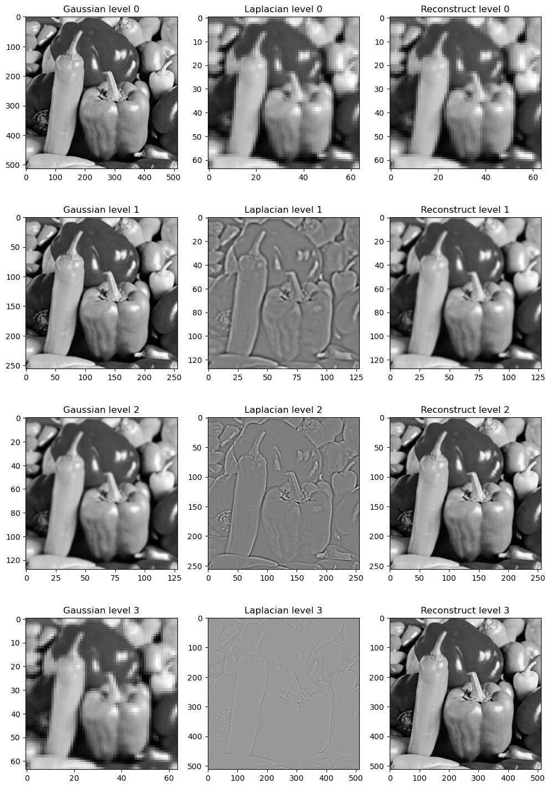
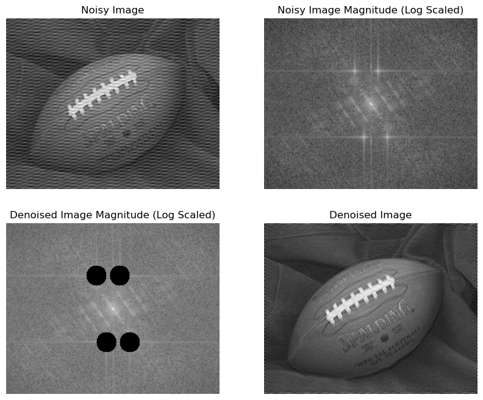

# Assignment 1 — Image Processing Fundamentals

**Course:** Machine Vision

This assignment covers fundamental image processing techniques, including contrast enhancement, histogram equalization, Fourier transform analysis, edge detection, image pyramids, and frequency-domain noise removal.

## Requirements

```bash
pip install numpy matplotlib opencv-python
```

## 1. Percentile Contrast Stretching

Implemented Min-Max and Percentile Contrast Stretching to improve the contrast of an X-ray image.

Conventional Min-Max stretching can be affected by histogram outliers, resulting in poor contrast enhancement. Percentile stretching addresses this issue by clipping intensity values outside the 1st and 99th percentiles before expanding the remaining range to [0, 255].



*Comparison of the original image, Min-Max stretching, and Percentile Contrast Stretching with their corresponding histograms.*

## 2. Histogram Equalization

Applied histogram equalization to an image with eight intensity levels using the cumulative distribution function (CDF).

The transformation is calculated as:

$$
T(r_k)=\left\lfloor (L-1)\sum_{j=0}^{k}p(r_j)\right\rfloor
$$

where \(L=8\) is the number of intensity levels and \(p(r_j)\) is the normalized frequency of each intensity.

The original and equalized histograms are compared below.



## 3. Fourier Phase and Magnitude

Computed the 2D Fourier transform of `building.jpg` and investigated the contributions of its magnitude and phase components to image reconstruction.

Two experiments were performed:

- **Phase-only reconstruction:** Set the magnitude spectrum to 1 while preserving the original phase.
- **Magnitude-only reconstruction:** Preserved the magnitude spectrum while setting the phase to zero.



The phase-only reconstruction retains much of the original image structure, demonstrating the importance of phase information in image representation.

## 4. Canny Edge Detection

Implemented the first three stages of the Canny edge detection algorithm:

1. Gaussian filtering for noise reduction.
2. Sobel operators for gradient magnitude and direction calculation.
3. Non-maximum suppression for edge thinning.

The implementation was tested on a grayscale pepper image.



## 5. Laplacian Image Pyramid

Constructed a three-level Laplacian image pyramid using Gaussian smoothing and downsampling.

Each Laplacian level is obtained by subtracting an expanded Gaussian pyramid level from the corresponding higher-resolution level.

The original image is reconstructed by progressively expanding and adding the Laplacian levels.



## 6. Periodic Noise Removal in the Frequency Domain

Implemented frequency-domain noise removal for `noiseball.png` using notch reject filters.

The procedure consists of:

1. Computing and visualizing the shifted Fourier magnitude spectrum.
2. Identifying the symmetric frequency peaks corresponding to periodic noise.
3. Designing circular notch filters to suppress the identified frequencies.
4. Applying the inverse Fourier transform to reconstruct the denoised image.



## Repository Structure

```text
Assignment-1/
│
├── Assignment1.ipynb
├── imgs/
│   ├── x-ray.PNG
│   ├── building.jpg
│   ├── pepper.jpg
│   └── noiseball.png
│
└── figs/
    ├── q1_contrast_stretching.png
    ├── q2_histogram_equalization.png
    ├── q3_fourier_phase_magnitude.png
    ├── q4_canny_steps.png
    ├── q5_laplacian_pyramid.png
    └── q6_notch_filter_denoising.png
```

## Technologies

- Python
- NumPy
- OpenCV
- Matplotlib

---

*This assignment was completed as part of the Machine Vision coursework.*