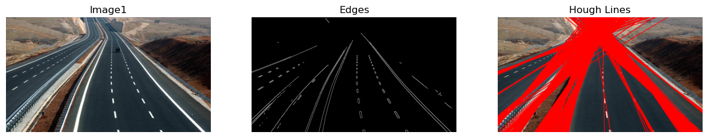
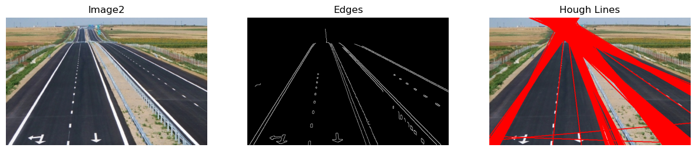
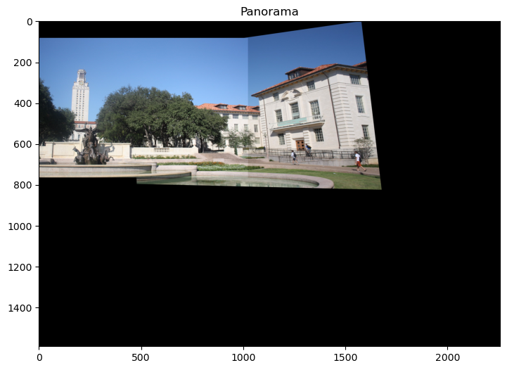

# Assignment 2 — Feature Detection and Image Matching

## Overview

This assignment covers three computer vision tasks: line detection using the Hough Transform, face recognition using SIFT features, and image stitching using feature matching and RANSAC.

## Q1. Line Detection using Hough Transform

The Hough Transform was implemented from scratch to detect lines in two highway images.

The implementation includes Gaussian smoothing, Canny edge detection, accumulator voting, and threshold-based line selection. The line equation in polar form is:

$$
\rho = x\cos(\theta) + y\sin(\theta)
$$

**Results and Discussion:** Although edge filtering removed many unwanted edges, the Hough Transform still detected some extra lines. However, with the selected parameters, most of the main lines were successfully identified. One exception was the dashed white line on the left side of the first image, which was not detected.

Compared with RANSAC, the Hough Transform identifies multiple lines in a single voting process, while standard RANSAC typically finds one dominant line at a time and requires iterative execution to detect additional lines. RANSAC may be more robust to outliers when identifying a dominant line, whereas Hough Transform is convenient for detecting multiple lines simultaneously.

**Results:**





## Q2. Face Recognition using SIFT

A face recognition system was implemented using SIFT keypoints and descriptors.

- **Dataset:** 750 images from 50 individuals, with 15 images per person.
- **Training:** First 8 images of each individual.
- **Testing:** Remaining 7 images.
- **Matching:** Euclidean distance between SIFT descriptors, with matches ranked by the number of descriptors below a distance threshold.

The first test image of each individual was used as a query. The experiment was evaluated using Rank-1 and Rank-14 accuracy.

**Results:**

| Distance Threshold | Rank-1 Accuracy | Rank-14 Accuracy |
|---|---:|---:|
| 200 | 94% (47/50) | 98% (49/50) |
| 300 | 88% (44/50) | 100% (50/50) |

A lower threshold produced better Rank-1 accuracy, while the higher threshold improved Rank-14 accuracy. This shows the effect of the matching threshold on the recognition results.

## Q3. Image Stitching using Feature Matching and RANSAC

A panorama was generated from two overlapping images.

The implementation uses Harris corner detection to identify keypoints, SIFT to extract descriptors, and descriptor matching to find correspondences. RANSAC was then used to estimate the homography matrix and align the images.

**Estimated Homography Matrix:**

$$
H =
\begin{bmatrix}
0.7511 & 0.0248 & 445.8872 \\
-0.1402 & 0.8915 & 80.1712 \\
-0.000225 & -0.000052 & 1
\end{bmatrix}
$$

**Result:**



## Requirements

Install the required Python libraries:

```bash
pip install numpy matplotlib opencv-python scipy
```

## Repository Structure

```text
Assignment2/
├── .gitignore
├── Assignment2.ipynb
├── imgs/
│   ├── highway1.jpg
│   ├── highway2.jpg
│   ├── cropped_faces/  # Ignored by Git; not included in the repository
│   ├── uttower_left.jpg
│   └── uttower_right.jpg
└── figs/
    ├── q1_hough_highway1.png
    ├── q1_hough_highway2.png
    └── q3_panorama.png
```

## Technologies

- Python
- NumPy
- OpenCV
- SciPy
- Matplotlib

---

*This assignment was completed as part of the Machine Vision coursework.*