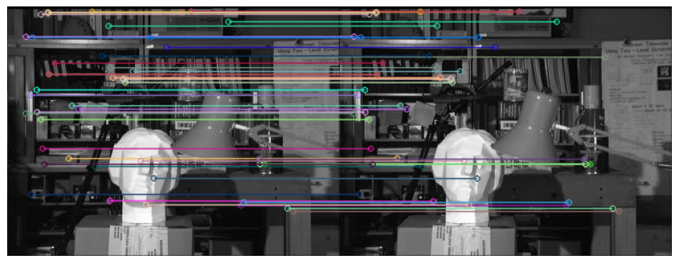
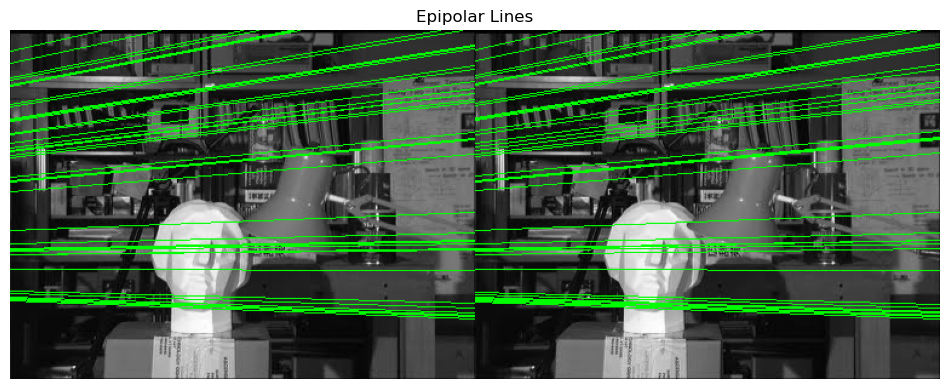
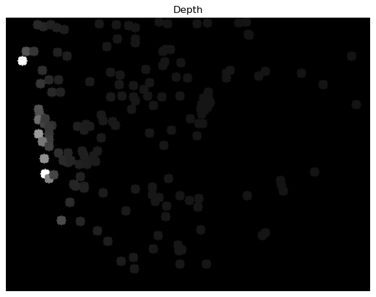
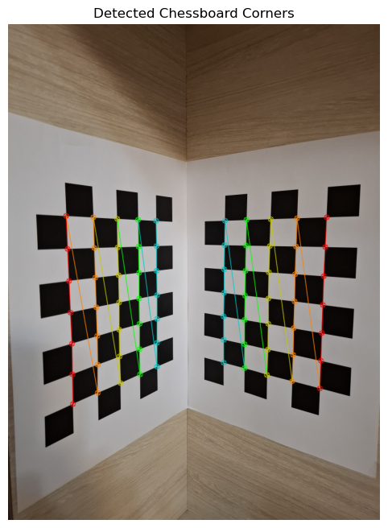
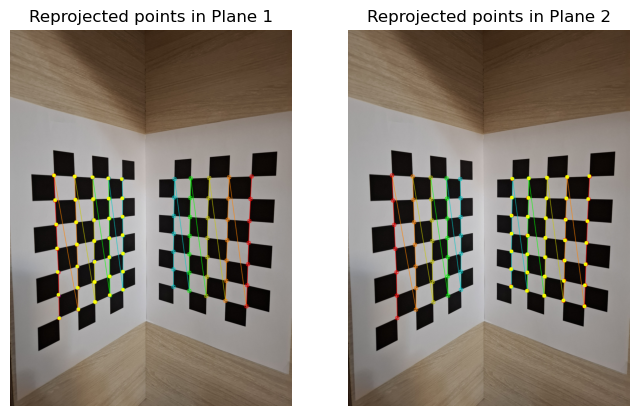

# Assignment 3 — 3D Reconstruction and Camera Calibration

## Overview

This assignment covers two topics:
1. **3D Reconstruction:** Feature matching, fundamental matrix estimation, epipolar geometry, and depth estimation from a stereo image pair.
2. **Camera Calibration:** Estimating camera parameters using two perpendicular checkerboard patterns.

## Question 1 — 3D Reconstruction

SIFT features were detected in the left and right images, and the best matches were selected using brute-force matching with cross-checking.

The fundamental matrix was estimated using RANSAC:

$$
F =
\begin{bmatrix}
1.22\times10^{-6} & -9.07\times10^{-4} & 0.1774 \\
9.18\times10^{-4} & -1.65\times10^{-5} & 0.6991 \\
-0.1788 & -0.7023 & 1
\end{bmatrix}
$$

A canonical first camera matrix was defined, and the second camera matrix was constructed using the fundamental matrix and the second epipole.

Epipolar lines were computed and visualized for the inlier correspondences. The lines are approximately parallel, indicating that the stereo pair has an approximately rectified geometry. Therefore, additional rectification is not necessary for this visualization.

Finally, corresponding points were triangulated to obtain 3D coordinates. Their depth values were normalized and displayed as grayscale points on a black image. Since the camera matrices are defined up to scale, the reconstructed depths are relative rather than metric.

**Results:**







## Question 2 — Camera Calibration

Camera calibration was performed using two perpendicular checkerboard patterns in a single image.

- Checkerboard inner corners: $7 \times 5$
- Square size: 2.65 cm
- Corner detection: OpenCV `findChessboardCorners`
- Corner refinement: `cornerSubPix`

The real-world 3D coordinates of the corners were defined for both perpendicular planes. The intrinsic camera matrix, distortion coefficients, and camera poses were then estimated using OpenCV's `calibrateCamera`.

**Estimated intrinsic matrix:**

$$
K =
\begin{bmatrix}
742.91 & 0 & 385.23 \\
0 & 730.21 & 522.41 \\
0 & 0 & 1
\end{bmatrix}
$$

The calibration returned an RMS reprojection error of **0.363 pixels**. The mean reprojection error calculated separately for the two planes was **0.0586 pixels**.

The projection matrices were obtained using:

$$
P = K[R \mid t]
$$

To evaluate the calibration, the detected image points were compared with the reprojected 3D points.

**Results:**





## Requirements

```bash
pip install numpy opencv-python matplotlib
```

## Repository Structure

```text
Assignment3/
├── Assignment3.ipynb
├── imgs/
│   ├── Q1-Left.jpg
│   ├── Q1-Right.jpg
│   └── image2.jpg
└── figs/
    ├── q1_feature_matches.png
    ├── q1_epipolar_lines.png
    ├── q1_depth_map.png
    ├── q2_detected_corners.png
    └── q2_reprojected_points.png
```

## Technologies

- Python
- NumPy
- OpenCV
- Matplotlib

---

*This assignment was completed as part of the Machine Vision coursework.*