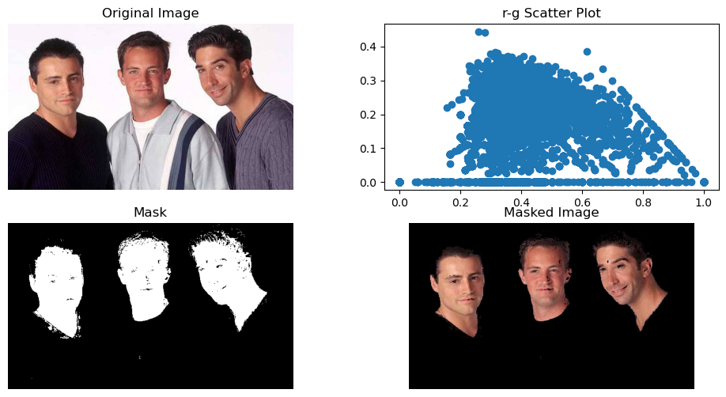
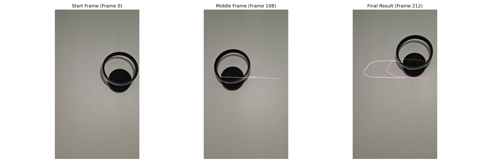
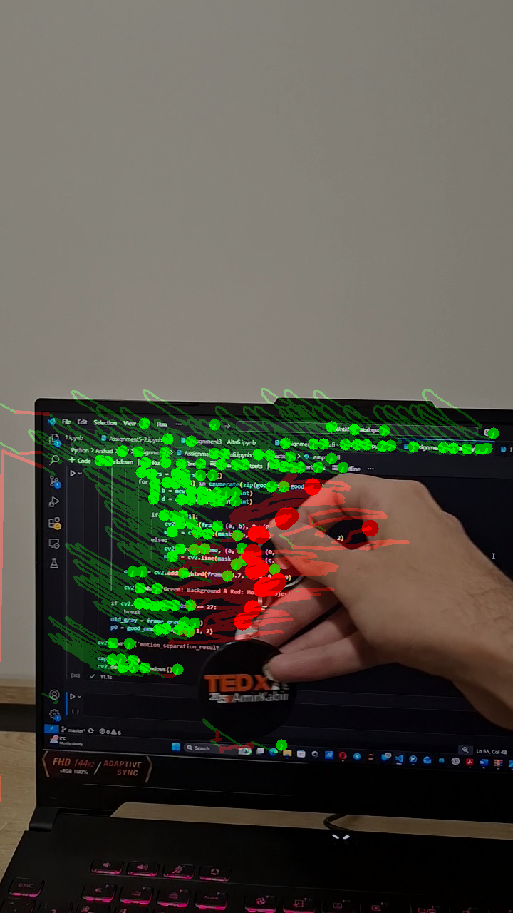

# Assignment 4 — Color Spaces and Feature Tracking

## Overview

This assignment covers color space transformations, skin-color segmentation, optical flow-based feature tracking, and separating independently moving objects from camera motion.

## Question 1 — Color Spaces

Different color spaces were explored using a sample image.

- **RGB:** The red, green, and blue channels were extracted and visualized separately.
- **XYZ:** The CIE XYZ color space represents colors independently of specific display devices. Its full gamut cannot be reproduced by physical displays because display primaries and their achievable color ranges are limited.
- **HSV:** A custom function was implemented to convert RGB to HSV. The channels represent Hue (color), Saturation (color intensity), and Value (brightness).
- **Y'CbCr:** A custom conversion function was implemented. Y represents luma, while Cb and Cr represent blue-difference and red-difference chroma components.
- **Grayscale:** A weighted sum of RGB channels was used to calculate intensity:

$$
Gray = 0.299R + 0.587G + 0.114B
$$

- **Normalized RGB and Face Segmentation:** RGB values were normalized by their channel sum. A mask was created using thresholds on the normalized red and green channels to identify skin-colored regions and extract the faces.

**Result:**



The transformations were implemented manually rather than using OpenCV's built-in color conversion functions.

## Question 2 — Lucas–Kanade Feature Tracking

The Shi–Tomasi corner detector (`goodFeaturesToTrack`) was used to select feature points in the first video frame. These points were tracked across subsequent frames using OpenCV's pyramidal Lucas–Kanade optical flow implementation (`calcOpticalFlowPyrLK`).

The algorithm estimates point displacement by minimizing the difference between image patches across consecutive frames. A pyramidal approach helps handle larger motions.

Tracking trajectories and current point positions were visualized in the video. Results from the beginning, middle, and end of the sequence were selected for comparison.

**Result:**



## Question 3 — Separating Camera Motion and Moving Objects

To distinguish points belonging to the background from independently moving objects, the tracked correspondences were used to estimate a dominant affine transformation with RANSAC (`estimateAffinePartial2D`).

- **Inliers (green):** Points consistent with the dominant camera-induced motion, generally belonging to the background.
- **Outliers (red):** Points that do not follow the estimated motion, potentially belonging to independently moving objects.

RANSAC estimates the dominant motion while rejecting correspondences that do not fit the model. The resulting inlier/outlier classification was visualized with colored points and trajectories.

**Result:**

<p align="center">
  
</p>

## Requirements

```bash
pip install numpy opencv-python matplotlib
```

## Repository Structure

```text
Assignment4/
├── Assignment4.ipynb
├── img_and_vids/
│   ├── 1.jpg
│   ├── vid1.mp4
│   └── vid2.mp4
└── figs/
    ├── q1_face_detection_mask.png
    ├── q2_lk_tracking.png
    └── q3_motion_separation.png
```

## Technologies

- Python
- NumPy
- OpenCV
- Matplotlib

---

*This assignment was completed as part of the Machine Vision coursework.*